# Implementation Stages Plan
## Material Consumption Intelligence System (10-Stage Roadmap)

---

## Roadmap Overview

```mermaid
flowchart LR
    S1["Stage 1: Core Schema & DB"] --> S2["Stage 2: Auth & Session"]
    S2 --> S3["Stage 3: Material Master"]
    S3 --> S4["Stage 4: Floor Entry UX"]
    S4 --> S5["Stage 5: Ledger Engine"]
    S5 --> S6["Stage 6: Intelligence Engine"]
    S6 --> S7["Stage 7: Reports & Exports"]
    S7 --> S8["Stage 8: Executive Dashboard"]
    S8 --> S9["Stage 9: Automated Testing"]
    S9 --> S10["Stage 10: Prod Deployment"]
```

---

### Stage 1: Core Schema & SQLite Engine Migration ✅
**Focus**: Resolve database engine compatibility and generate type-safe ORM layers.
- **Tasks**:
  - Convert native `enum` declarations in `prisma/schema.prisma` to SQLite-compatible string fields with application-level constraints.
  - Generate Prisma Client v5.22.0.
  - Synchronize SQLite schema (`dev.db`).
  - Execute database seeder with polymer & chemical compounding categories and materials transcribed from the factory register.
- **Deliverables**: Working `dev.db`, verified `prisma/schema.prisma`, and passing `npx prisma generate`.
- **Status**: ✅ **COMPLETED & VERIFIED**

---

### Stage 2: Authentication, Session Tokenization & Middleware Hardening ✅
**Focus**: Role-based access control and session management for industrial LANs.
- **Tasks**:
  - Implement HMAC-SHA256 cookie session signing and validation using universal Web Crypto API (`crypto.subtle`) in `src/lib/session.ts`.
  - Secure `/login` endpoint with `bcryptjs` password verification.
  - Guard route boundaries in `src/middleware.ts` with role redirects.
  - Ensure 100% Next.js Edge runtime compatibility without Node module warnings.
- **Deliverables**: Secure login flow, automatic session cookie assignment, role-gated routes.
- **Status**: ✅ **COMPLETED & VERIFIED**

---

### Stage 3: Material Master & Dynamic Taxonomy System ✅
**Focus**: 100% database-driven material catalog without hardcoded chemicals or categories.
- **Tasks**:
  - CRUD API endpoints for Materials (`/api/materials`), Categories, Shifts, and Reason Codes.
  - Material list UI (`/materials`) with real-time stock balances and status badges (`ACTIVE`, `INACTIVE`, `ARCHIVED`).
  - Form support for masterbatch color names, pigment ratios, minimum safety stock, and unit costs.
  - Integration with `writeAuditLog()` to track catalog mutations.
- **Deliverables**: Materials management interface and dynamic taxonomy settings.
- **Status**: ✅ **COMPLETED & VERIFIED**

---

### Stage 4: High-Velocity Shop-Floor Entry & Optimistic UI Pipeline ✅
**Focus**: Ergonomic, rapid transaction logging for shift operators on mobile and tablet devices.
- **Tasks**:
  - Single-screen fast entry form (`/entry`) with keyboard/touch optimization.
  - Implement role-gated transaction types:
    - *Operator*: Usage, Wastage, Return.
    - *Supervisor*: Purchase, Adjustment, Transfer.
    - *Admin*: Opening Balance.
  - Configure TanStack React Query optimistic stock updates to eliminate screen reloads during entry.
  - Comprehensive Zod validation rejecting zero/negative quantities and missing required references.
- **Deliverables**: Operational `/entry` page with optimistic cache updates and error toast rollbacks.
- **Status**: ✅ **COMPLETED & VERIFIED**

---

### Stage 5: Live Ledger Explorer & Historical Reconciler ✅
**Focus**: Full financial statement-style ledger views for individual materials and overall plant movements.
- **Tasks**:
  - Implement statement-style chronological ledger at `/materials/[id]` with continuous running balance calculation.
  - Global ledger table at `/transactions` supporting multi-filter queries (Date Range, Shift, Material, Transaction Type, Batch Number).
  - Material detail sheet showing safety stock status and shift distribution.
- **Deliverables**: Auditable bank-statement view for every factory material.
- **Status**: ✅ **COMPLETED & VERIFIED**

---

### Stage 6: Deterministic Intelligence & Forecasting Engine ✅
**Focus**: Offline mathematical heuristics for stockout prevention and process anomalies.
- **Tasks**:
  - Implement trailing 30-day average daily consumption ($ADC_{30}$) calculator in `src/lib/analytics.ts`.
  - Automated days-remaining forecasting with color-coded alert tiers (*Critical*, *Warning*, *Watch*).
  - Trailing 7-day vs. 30-day baseline abnormal consumption detector (flagging spikes/drops $\ge 25\%$).
  - 30-day dead-stock detector identifying inactive capital.
  - Month-over-Month (MoM) consumption trajectory classifier.
- **Deliverables**: Interactive `/analytics` intelligence dashboard.
- **Status**: ✅ **COMPLETED & VERIFIED**

---

### Stage 7: Industrial Reporting & Multi-Format Exporters ✅
**Focus**: Auditable operational reports with client-side document generation.
- **Tasks**:
  - Fix calculation bugs in `/api/reports` ensuring `opening` and `closing` balances strictly reconcile.
  - Multi-period aggregation: Daily, Weekly, Monthly, Quarterly, Yearly, and Production Batch.
  - Implement client-side export pipelines in `src/lib/export.ts`:
    - Clean CSV export with comma escaping.
    - Formatted Excel (.xlsx) workbooks via SheetJS.
    - Timestamped PDF report tables with auto-table formatting via jsPDF.
- **Deliverables**: Fully reconciled `/reports` dashboard with working CSV, Excel, and PDF downloads.
- **Status**: ✅ **COMPLETED & VERIFIED**

---

### Stage 8: Executive Valuation & Wastage Analytics ✅
**Focus**: High-level working capital and scrap monitoring for plant management.
- **Tasks**:
  - Real-time inventory valuation calculation ($\sum \text{Stock}_i \times \text{Cost}_i$).
  - Scrap and wastage percentage tracking against total gross consumption.
  - Top consumed and high-velocity materials ranking table.
  - Quick-view forecasted stock-out list for executive oversight.
- **Deliverables**: Dedicated `/executive` dashboard restricted to Admins and Supervisors.
- **Status**: ✅ **COMPLETED & VERIFIED**

---

### Stage 9: Comprehensive Automated Test Suite ✅
**Focus**: Verifying mathematical invariants, ledger integrity, and API permissions.
- **Tasks**:
  - Unit tests for `signedQuantity()` and `sumSigned()` in `src/lib/stock.ts`.
  - Mathematical invariant test: $\text{Closing} = \text{Opening} + \text{In} - \text{Out} \pm \text{Adjustments}$.
  - Validation schemas testing for non-zero movements and minimum stock bounds.
  - Web Crypto HMAC session signing and tampering verification tests.
  - End-to-end integration tests (`tests/e2e-integration.test.ts`) against live database.
- **Deliverables**: Automated test suite (`npm test` / 13 tests across 6 suites) with 100% pass rate.
- **Status**: ✅ **COMPLETED & VERIFIED**

---

### Stage 10: Production Hardening, SQLite WAL Mode & Container Deployment ✅
**Focus**: Multi-user concurrency tuning, automated backups, and containerized rollout.
- **Tasks**:
  - Enable SQLite Write-Ahead Logging (`PRAGMA journal_mode=WAL`) and configure connection busy timeout of 5,000 ms in `src/lib/prisma.ts`.
  - Multi-stage Docker build configuration via `Dockerfile` and `docker-compose.yml`.
  - Verified full production build (`npm run build`) generating all 24 routes with 0 warnings.
- **Deliverables**: Hardened production database connection layer, Docker readiness, zero-warning build output.
- **Status**: ✅ **COMPLETED & VERIFIED**
