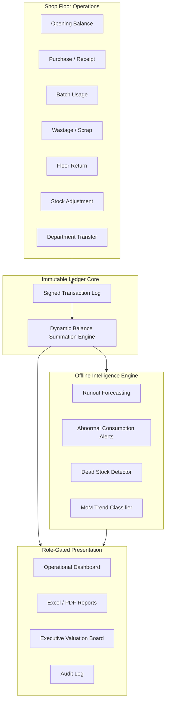

# Product Requirements Document (PRD)
## Material Consumption Intelligence System

---

## 1. Executive Summary & Vision

The **Material Consumption Intelligence System** is an offline-first, on-premise manufacturing inventory and intelligence platform designed to replace manual, error-prone paper stock registers in polymer and chemical compounding factories.

Unlike traditional ERPs that maintain a mutable "current stock" quantity—leading to reconciliation drift, unrecorded spillage, and untracked manual corrections—this system is built on a **pure, immutable double-entry style stock ledger**. Every movement on the plant floor (receipts, batch consumption, spillage, quality rejections, transfers, and inventory reconciliations) is recorded as a discrete signed transaction. Stock is always derived dynamically by summing these transactions.

Furthermore, the system provides **deterministic, offline intelligence** without requiring external cloud AI or LLM APIs: automated stock-out forecasting, anomaly/spike detection, dead-stock monitoring, and month-over-month consumption trends calculated directly on the factory's local infrastructure.

---

## 2. Problem Statement & Background

### 2.1 The Current State (Paper Register)
In the target compounding plant, materials (e.g., EVA resins, POE, EPDM rubber, crosslinking agents like DCP, blowing agents, silica, and color masterbatches) are tracked on handwritten paper sheets per shift. 
Key failure points of this legacy workflow:
- **Illegibility & Data Loss**: Handwriting ambiguities (e.g., confusing "DCP" with "DLP", or unclear opening balances) create unrecoverable inventory gaps.
- **Delayed Visibility**: Production heads and store managers only discover material shortages after a line shutdown occurs.
- **Untracked Wastage**: Scrap and floor spillage are often swept into general consumption or unrecorded.
- **No Predictive Planning**: Calculating lead times and reorder dates requires manual math, leading to stockouts of long lead-time chemicals.
- **Audit Deficits**: No verifiable record exists of who adjusted a balance or when an alteration was made.

### 2.2 Desired State
A low-latency, mobile-responsive local web platform accessible via floor tablets and desktop terminals across all plant shifts (Morning, Evening, Night) that provides instantaneous stock visibility, role-gated transactional control, automated stock-out alerts, and one-click regulatory and operational reports.

---

## 3. Target User Personas

| Persona | Role | Primary Goals & Workflows | Key Pain Points |
| :--- | :--- | :--- | :--- |
| **Plant Operator** | Shop floor technician / batch mixer | Rapidly log material usage, scrap, and returns per batch/shift without typing long descriptions. | Complex UIs with too many fields; slow networks; fear of making permanent mistakes. |
| **Shift Supervisor** | Production & shift lead | Authorize receipts (Purchase), approve count corrections (Adjustment), review shift consumption summaries. | Discrepancies between physical bins and ledger; shift handover reconciliation gaps. |
| **Store / Inventory Manager** | Warehouse & logistics lead | Monitor minimum stock thresholds, forecast reorder windows, track supplier batches, export reports. | Unexpected stockouts of imported additives; slow manual month-end reconciliation. |
| **General Manager / Plant Head** | Executive oversight | Review total inventory valuation, monitor material wastage %, compare MoM consumption trends. | Lack of high-level cost visibility; delayed reporting from floor supervisors. |

---

## 4. Product Scope & Functional Requirements

### 4.1 Ledger Engine & Transaction Management
- **FR-1.1 Immutable Transactions**: The system shall never maintain a mutable `current_stock` column. All stock numbers must be computed live by summing signed quantities:
  - **Positive (+)**: `OPENING`, `PURCHASE`, `RETURN`
  - **Negative (-)**: `USAGE`, `WASTAGE`, `TRANSFER`
  - **Signed (+ / -)**: `ADJUSTMENT` (physical count corrections)
- **FR-1.2 Batch Tracking**: Support optional tracking of manufacturer and internal production batch numbers on all transactions.
- **FR-1.3 Shift & Reason Association**: Every floor movement must be tagged with a plant shift (Morning/Evening/Night) and a standardized reason code (e.g., *Regular Production*, *Spillage*, *Trial Batch*, *Contamination*).

### 4.2 Material Master & Categorization
- **FR-2.1 Flexible Catalog**: Store materials with Name, Category, Primary Unit of Measure (kg, g, L, bags, pcs), and Minimum Safety Stock threshold.
- **FR-2.2 Compound Color Tracking**: Support optional masterbatch color attributes (Color Name, Pigment Ratio/Quantity, and Color Unit).
- **FR-2.3 Unit Costing**: Optional unit cost field enabling real-time valuation of standing inventory on executive dashboards.
- **FR-2.4 Lifecycle States**: Materials can transition between `ACTIVE`, `INACTIVE`, and `ARCHIVED` without breaking historical ledger integrity.

### 4.3 High-Velocity Daily Entry (`/entry`)
- **FR-3.1 Mobile/Tablet Optimized**: Single-screen, rapid-entry form designed for greasy or gloved floor operations.
- **FR-3.2 Optimistic UI Updates**: Using TanStack React Query, updating the UI instantaneously without requiring full-page reloads.
- **FR-3.3 Role-Gated Transaction Types**:
  - *Operators*: Usage, Wastage, Return.
  - *Supervisors*: Purchase, Adjustment, Transfer (+ Operator types).
  - *Admins*: Opening Balance (+ all types).

### 4.4 Material Ledger & Bank-Statement View (`/materials/[id]`)
- **FR-4.1 Chronological Ledger**: Complete running-balance history for any material, formatted like a bank account statement (Date, Shift, Type, Quantity In/Out, Running Balance, User, Batch, Notes).
- **FR-4.2 Real-Time Filtering**: Filter ledger entries by date range, transaction type, or shift.

### 4.5 Offline Intelligence & Analytics (`/analytics`)
- **FR-5.1 Stock-Out Runout Forecasting**: Compute average daily consumption over a trailing 30-day window ($ADC_{30}$). Calculate days remaining:
  $$\text{Days Remaining} = \frac{\text{Current Stock}}{ADC_{30}}$$
  Assign alert tiers:
  - **Critical**: $< 7\text{ days}$ (or below Minimum Safety Stock).
  - **Warning**: $7 - 14\text{ days}$.
  - **Watch**: $14 - 30\text{ days}$.
- **FR-5.2 Abnormal Consumption Detection**: Compare a material's recent 7-day daily average against its prior 30-day baseline (excluding the recent 7 days). Flag any deviation $\ge 25\%$ as a *Spike* or *Drop*.
- **FR-5.3 Dead Stock Detection**: Flag active materials holding stock $> 0$ with zero recorded movements over the past 30 days.
- **FR-5.4 Month-over-Month (MoM) Trend Engine**: Classify consumption trajectory (*Surging*, *Rising*, *Steady*, *Cooling*, *Plunging*) by comparing current month usage against prior month.

### 4.6 Reporting & Export Engine (`/reports`)
- **FR-6.1 Time Horizons**: Generate summaries for Daily, Weekly, Monthly, Quarterly, Yearly, and Batch-specific periods.
- **FR-6.2 Balance Reconciliation**: Each report row must strictly satisfy the inventory equation:
  $$\text{Opening} + \text{Purchased} + \text{Returned} - \text{Consumed} - \text{Wastage} + \text{Adjustments} - \text{Transferred} = \text{Closing}$$
- **FR-6.3 Client-Side Exporters**: Export formatted reports directly in the browser to:
  - **CSV** (plain text comma-separated)
  - **Excel (.xlsx)** via SheetJS
  - **PDF (.pdf)** with branded tables and timestamps via jsPDF / AutoTable.

### 4.7 Executive Dashboard (`/executive`)
- **FR-7.1 Total Working Capital**: Aggregate total value of plant stock ($\sum \text{Stock}_i \times \text{Cost}_i$).
- **FR-7.2 Scrap & Wastage Ratio**: Compute total scrap material as a percentage of total consumed material.
- **FR-7.3 Top Mover Ranking**: Rank materials by absolute consumption and value velocity.

### 4.8 Security, User Management & Auditing (`/settings`, `/audit-log`)
- **FR-8.1 RBAC Enforcement**: Enforce permission gates across routes and API endpoints for `ADMIN`, `SUPERVISOR`, and `OPERATOR`.
- **FR-8.2 Immutable Audit Trail**: Record every entity creation, modification, archive, and deletion in an `AuditLog` table with old vs. new JSON snapshots, user ID, and timestamp.

---

## 5. Non-Functional Requirements (NFR)

1. **Zero External Internet Egress**: The software must execute, compute, render, and export without an active internet connection.
2. **Sub-Second Response Times**: Stock calculation queries across active materials must resolve in $< 50\text{ ms}$ for typical factory volumes ($< 50,000$ transactions/year).
3. **Data Durability**: Database file must reside on persistent storage with automated backup mechanisms.
4. **Responsive Display**: Fully accessible on screens ranging from 375px mobile displays (floor tablets) to 1920px control room monitors.
5. **Theme Support**: High-contrast Dark Mode and Light Mode support for varying plant lighting conditions.

---

## 6. Success Metrics & Key Performance Indicators (KPIs)

- **Inventory Accuracy**: Discrepancy between physical stock counts and ledger balances reduced to $< 1\%$.
- **Stock-Out Incidents**: Zero unplanned production halts caused by unflagged raw material exhaustion.
- **Reconciliation Time**: Month-end store closing time reduced from 3 business days to under 5 minutes.
- **Audit Compliance**: 100% of material adjustments backed by a verified user ID and timestamped audit log entry.